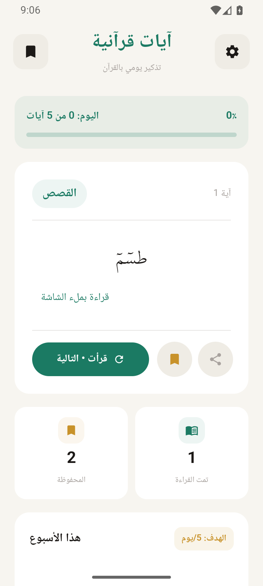
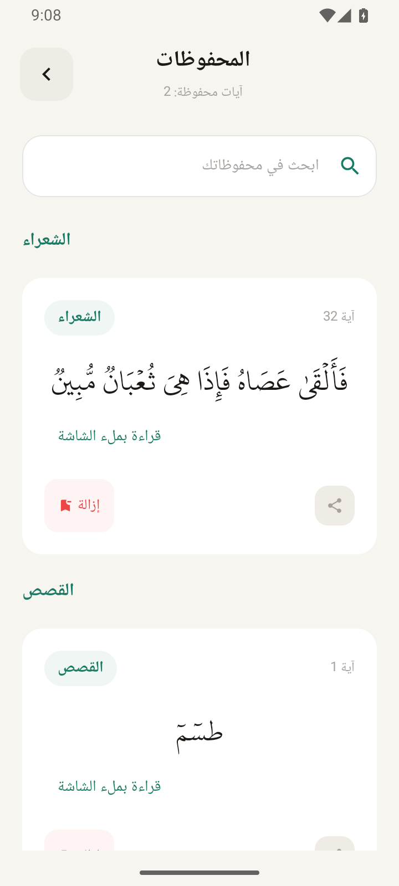
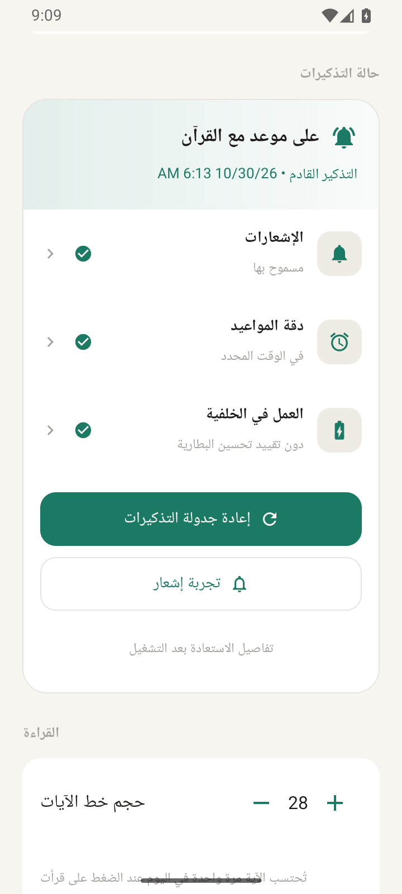
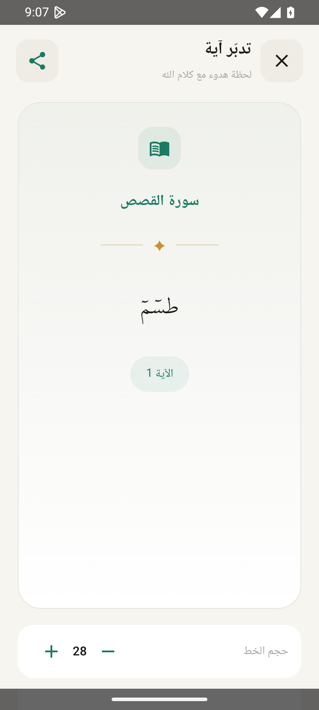

<div align="center">

# 📖 Ayat Quran | آيات القرآن

### ✨ The Holy Quran, beautifully in your pocket ✨


[🌐 Website](https://omer73364.github.io/Ayat-Quran) · [📲 Download APK](#-download) · [📸 Screenshots](#-screenshots) · [✨ Features](#-features)

</div>

---

## 🌙 About

**Ayat Quran** is a simple and elegant Android app that lets you read the Holy Quran anytime, anywhere, with a clean design and a smooth experience.

> 💚 Made with love, to bring the Quran closer to everyone.

## ✨ Features

|     | Feature             | Description                       |
| --- | ------------------- | --------------------------------- |
| 📚  | **Complete Quran**  | All 114 surahs, every ayah        |
| 🔍  | **Quick Search**    | Find any verse in seconds         |
| 🔖  | **Bookmarks**       | Save your place and favorite ayat |
| 🌗  | **Dark Mode**       | Comfortable reading day or night  |
| 🔠  | **Adjustable Text** | Change the font size to suit you  |
| 📴  | **Works Offline**   | No internet needed                |
| ⚡  | **Light & Fast**    | Small size, smooth performance    |

<!-- Edit this list so it matches your app's real features -->

## 📸 Screenshots

<div align="center">






</div>

## 📲 Download

<div align="center">

[](https://github.com/omer73364/Ayat-Quran/releases/download/v1.1.1/Ayat-Quran-v1.1.1.apk)

_Requires Android 8.0 or higher_

</div>

## 🛠️ Built With

- 🤖 **Android** (Kotlin / Java)
- 🎨 **Material Design**
- 🗄️ **[Room / SQLite / JSON]**

## 🚀 Build It Yourself

```bash
# 1️⃣ Clone the repo
git clone https://github.com/omer73364/Ayat-Quran.git

# 2️⃣ Open it in Android Studio

# 3️⃣ Let Gradle sync, then press ▶️ Run
```

## 🗂️ Project Structure

```
Ayat-Quran/
├── 📁 app/
│   └── 📁 src/main/
│       ├── 📁 java/    # App code
│       └── 📁 res/     # Layouts, images, strings
├── 📁 docs/            # Screenshots
└── 📄 README.md
```

## 📄 License

Distributed under the **[MIT]** License.

<div align="center">

---

Made with 💚 by [@omer73364](https://github.com/omer73364)

_"The best among you are those who learn the Quran and teach it."_ 🌿

</div>
